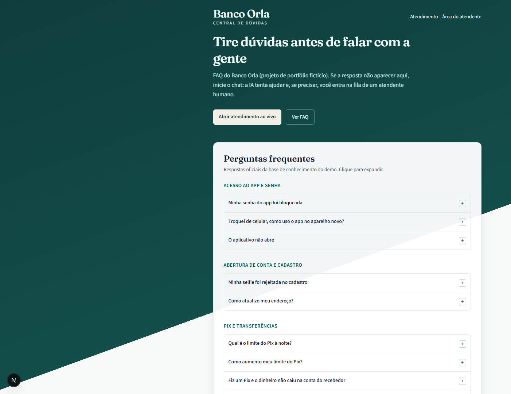
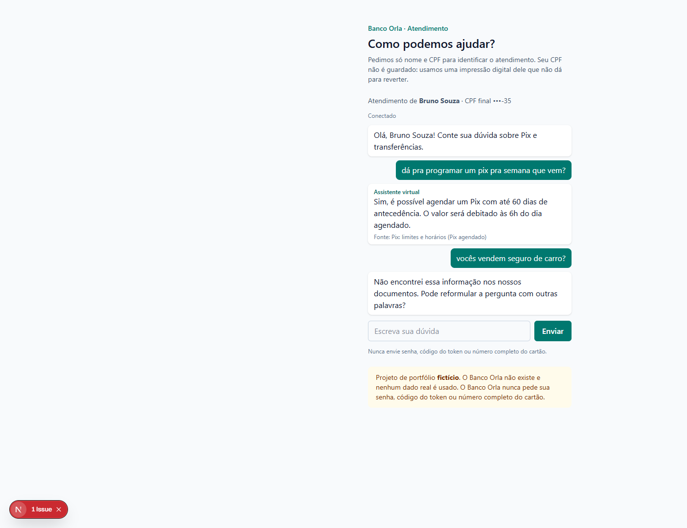

# Banco Orla — Atendimento com IA

> ⚠️ **Projeto de portfólio fictício.** O Banco Orla não existe; regras, limites e documentos são
> inventados para fins de estudo. Nenhum dado real é usado. Qualquer semelhança com instituição real
> é coincidência.

Atendimento em tempo real em que um assistente de IA responde dúvidas com base **só** em documentos
públicos do banco (RAG) e, quando não sabe, passa a conversa para um atendente humano.

**Status:** ✅ V1 funcional (etapas 0–9 + mesa/supervisor + Central de dúvidas). Vitrine LinkedIn =
este README + demo local ([plano](docs/plano.md)).

## Demo em 3 telas

| Quem      | URL local                         | O que ver                                   |
| --------- | --------------------------------- | ------------------------------------------- |
| Cliente   | http://127.0.0.1:3000/            | Central de dúvidas (FAQ por assunto)        |
| Cliente   | http://127.0.0.1:3000/atendimento | Cadastro → chat IA → fila humana            |
| Atendente | http://127.0.0.1:3000/atendente   | Mesa: fila expansível, preferencial, equipe |

Login demo: `ana@bancoorla.example` (atendente) · `sofia@bancoorla.example` (supervisor) · senha
`atendente-demo`.

## Por que este projeto

No estágio, trabalhei como atendente num chat de um órgão público: o cidadão passava por uma
triagem e caía na fila do atendente livre há mais tempo. Vi por dentro os gargalos — perguntas
repetidas, espera na fila, atendente recebendo a conversa sem contexto. Este projeto é a minha
versão desse sistema, construída do zero e com IA, num tema fictício (banco digital) para não expor
nada do órgão.

## Como funciona

```
pergunta → guarda de entrada → FAQ pronta? → busca híbrida (pgvector + texto)
        → trecho confiável? → Llama responde só com os trechos + fonte → guarda de saída
                         └─ não → "não sei" + atendente humano (fila com SKIP LOCKED)
```

- **Respostas prontas primeiro**: perguntas comuns não chamam a IA (rápido, grátis, sem inventar).
- **IA só quando precisa**: Llama 3.1 8B rodando local via Ollama, citando a fonte.
- **O modelo propõe, o código confere**: a resposta só chega ao cliente se citar um trecho real,
  se todo número dela estiver no trecho e se o texto for fiel ao que cita. Senão, "não sei".
  Medido com 30 perguntas (`pnpm eval:rag`): 23 de 24 da base com a fonte certa, 6 de 6 fora do
  assunto com "não sei", **nenhuma resposta inventada**, ~0,6 s por resposta.
- **Chat que não perde nem duplica mensagem**: confirmação do servidor, ordem definida no banco e
  reenvio automático quando a conexão volta.
- **IA sem acesso ao banco**: ela só vê a pergunta e trechos públicos; nunca pede senha ou token.
- **Mesa humana**: fila com `SKIP LOCKED`, cards expansíveis (nome, assunto, tempo de espera),
  **preferencial** (idoso/PCD/gestante) na frente + FIFO no empate, chat da equipe, papéis
  atendente vs supervisor.
- **Observabilidade**: `GET /metrics` (Prometheus), Grafana (`docker compose --profile obs`),
  `requestId` nos logs; CloudWatch emulado para a Lambda.
- **Guardas em código (não só no prompt)**: mascara CPF/cartão/senha; bloqueia injeção de prompt;
  barra na saída pedido de segredo, link falso e HTML. **40+ ataques** no CI.
- **Base com fluxo AWS**: S3 → SQS (+DLQ) → Lambda → pgvector, emulado com MiniStack (sem conta AWS).





## Stack

Next.js 16 · Node.js + Fastify · Socket.IO · PostgreSQL + pgvector · Ollama (Llama 3.1,
nomic-embed-text) · AWS S3 + SQS + Lambda (SDK v3, emulados com MiniStack) · Zod · Vitest ·
Docker Compose · GitHub Actions · pnpm + Turborepo · TypeScript

## Rodar localmente

Pré-requisitos: Node 22+, pnpm 10, Docker Desktop, [Ollama](https://ollama.com).

```bash
ollama pull llama3.1:8b && ollama pull nomic-embed-text
node scripts/gerar-env.mjs    # cria o .env com segredos aleatórios (nunca vai para o Git)
pnpm install
docker compose up -d          # Postgres + pgvector (:55432) e AWS emulada (:4566)
pnpm db:migrate && pnpm db:seed
pnpm kb:setup                 # cria bucket, filas (+DLQ), Lambda e gatilhos no MiniStack
pnpm kb:upload && pnpm kb:faq # envia os documentos e a FAQ; acompanhe com pnpm kb:status
pnpm dev                      # web em :3000, realtime em :4000
```

- Cliente: http://127.0.0.1:3000
- Painel do atendente: http://127.0.0.1:3000/atendente
- Observabilidade: `docker compose --profile obs up -d` → Grafana http://127.0.0.1:3001 · métricas
  http://127.0.0.1:4000/metrics

Verificações: `pnpm lint && pnpm typecheck && pnpm test && pnpm build` (os testes do banco sobem um
Postgres real em container — o Docker precisa estar aberto).

Avaliações da IA (precisam do Ollama e da base carregada): `pnpm eval:faq`, `pnpm eval:busca`
(Recall@5 e MRR da busca) e `pnpm eval:rag` (respostas de ponta a ponta com o Llama).

## O que um recrutador pode perguntar

| Tema                                                 | Resposta curta                                                                            |
| ---------------------------------------------------- | ----------------------------------------------------------------------------------------- |
| Por que RAG e não só o modelo?                       | O modelo inventa; a gente só responde com trecho recuperado e cita a fonte.               |
| Como a fila evita duas pessoas pegarem o mesmo caso? | `FOR UPDATE SKIP LOCKED` + oferta com TTL.                                                |
| Como a IA não vaza dados?                            | Sem acesso ao banco operacional; 4 ferramentas no máximo; guardas de entrada/saída no CI. |
| AWS de verdade?                                      | SDK oficial contra MiniStack local (S3/SQS/Lambda/CloudWatch) — zero custo, mesmo código. |

Mais trade-offs e escala (100 → 100 mil): [arquitetura-e-escala.md](docs/arquitetura-e-escala.md).

## Documentação

- [Segurança da IA (OWASP LLM Top 10)](docs/seguranca-ia.md)
- [Decisões de arquitetura (ADRs)](docs/decisoes/)
- [Arquitetura e escala: de 100 a 100 mil pessoas](docs/arquitetura-e-escala.md)
- [Uso de IA no desenvolvimento](docs/uso-de-ia.md)

## Repositórios

- **Este repo (público):** código da V1 para portfólio e LinkedIn.
- **Guia de estudo (privado):** perguntas de entrevista, vagas e PDF — não entram aqui.
- O repositório de desenvolvimento privado pode continuar existindo; este é o snapshot limpo para mostrar.

